<div align="center">



<a href="https://git.io/typing-svg">
  
</a>

<br/>

<a href="https://portofolio-web7.netlify.app/"></a>


</div>

<br/>

## 🔴 ABOUT ME

<table>
<tr>
<td width="340" valign="top" align="center">
  
</td>
<td valign="top">

```php
<?php

class Yazid
{
    public string $role = "Aspiring Software Developer";
    public string $base = "Indonesia";

    public array $focus     = ["PHP", "Laravel", "Web Apps"];
    public array $exploring = ["Python", "Computer Vision"];

    public function motto(): string
    {
        return "Code a little better than yesterday.";
    }
}
```

> 🎯 **Focus** · Web apps built around real use-cases
> 🧪 **Experimenting** · Hand gesture detection with Python
> 🚀 **Next** · Cleaner architecture, APIs, shipping more

</td>
</tr>
</table>

<br/>

## 🛠️ TECH STACK

<div align="center">


</div>

```text
PHP        ██████████░░  80%   ▸ daily driver
Laravel    ████████░░░░  65%   ▸ leveling up
JavaScript ███████░░░░░  60%   ▸ growing
Python     ██████░░░░░░  50%   ▸ exploring
HTML/CSS   █████████░░░  75%   ▸ solid
```

<br/>

## 🛰️ FEATURED PROJECTS

<div align="center">
<table>
<tr>
<td><a href="https://github.com/mohammadyazidur-creator/KasKita"></a></td>
<td><a href="https://github.com/mohammadyazidur-creator/Keuangan---pribadi"></a></td>
</tr>
<tr>
<td><a href="https://github.com/mohammadyazidur-creator/Sistem-Konsisten"></a></td>
<td><a href="https://github.com/mohammadyazidur-creator/projek---deteksi-gerakan-tangan_-yazid-3"></a></td>
</tr>
<tr>
<td colspan="2" align="center"><a href="https://github.com/mohammadyazidur-creator/undangan-pernikahan-web-proses-"></a></td>
</tr>
</table>
</div>

<br/>

## 📊 GITHUB ANALYTICS

<div align="center">


<br/>


<br/>


</div>

<br/>

## 🐍 CONTRIBUTION SNAKE

<div align="center">

</div>

<br/>

## 📬 CONNECT

<div align="center">

<a href="https://portofolio-web7.netlify.app/"></a>
<a href="https://github.com/mohammadyazidur-creator"></a>

```js
while (alive) { learn(); build(); ship(); repeat(); }
```


</div>
